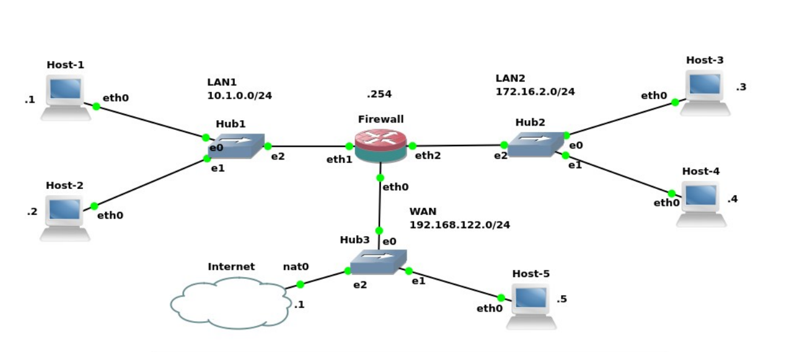

# firewall-rules
Laboratório acadêmico de segurança de redes utilizando iptables, com implementação de regras de filtragem, NAT, controle de acesso e testes em dois cenários de rede.

## Topologia da rede

